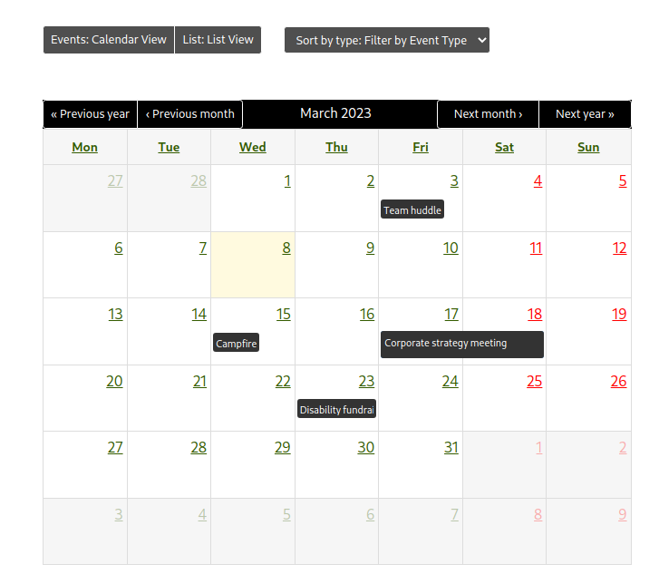
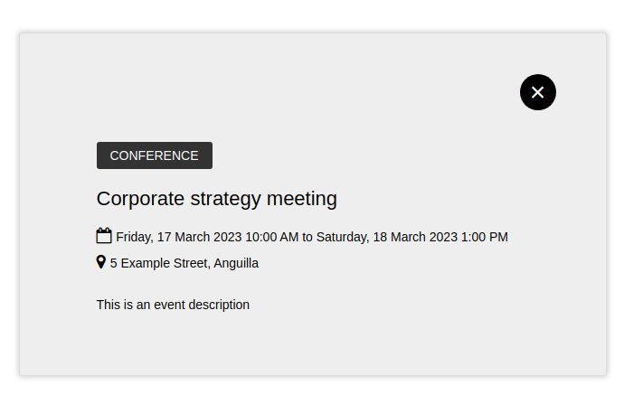

# Events Calendar Shortcode

Display a CiviCRM Events Calendar on your website using the [FullCalendar Javascript library](https://fullcalendar.io), see [https://fullcalendar.io](https://fullcalendar.io) for more details and [demonstrations](https://fullcalendar.io/demos) of the calendar options available.

Use WordPress shortcode `[ux_event_fullcalendar]` to display an interactive calendar of all CiviCRM Events which are both public and active.

## Shortcode options

You can include additional parameters in the fullcalendar shortcode to limit the scope of events shown on the calendar or to add extra visual features (colors, images) that are not included out of the box. None of these additional parameters are strictly required.
- *`types`* is a comma-separated list of Event Types (using Event Type Label) that can be used to filter Events by Event Type; e.g. `[ux_event_fullcalendar types="Workshop,Meeting,Exhibition"]` will show only events that are workshops, meetings or exhibitions. By default, FullCalendar will show all event types on your system.
- *`colors`* is a comma-separated list of hex rgb codes that can be used to apply a background colour to each Event Type, *without* the leading `#` character in the codes; e.g. `[ux_event_fullcalendar types="Workshop,Meeting,Exhibition" colors="52246d,c45472,ce8d8b"]` will apply the colours `#52246d`, `#c45472` and `#ce8d8b` to the Workshop, Meeting and Exhibition type events respectively. These will not be applied unless the `types` parameter is also include.
- *`start`* is the date from which active events will be displayed. For example, `[ux_event_fullcalendar start="2021-01-01"]` will show only events from the 1st of January 2021 onwards. If this parameter is not specified, the calendar will show events starting from 1 year prior to the current date.
- *`force_login`* - true or false; when true, the calendar forces anonymous users to log in before registering for an event.
- *`redirect_after_login`* - optionally provide a URL to redirect to after login. Useful if you have a custom Event registration page, instead of the default CiviCRM event registration page.
- *`img_src_field`*: the field name the path to the event image. This must be a custom text field for CiviCRM events, containing a path relative to the WordPress uploads directory,
