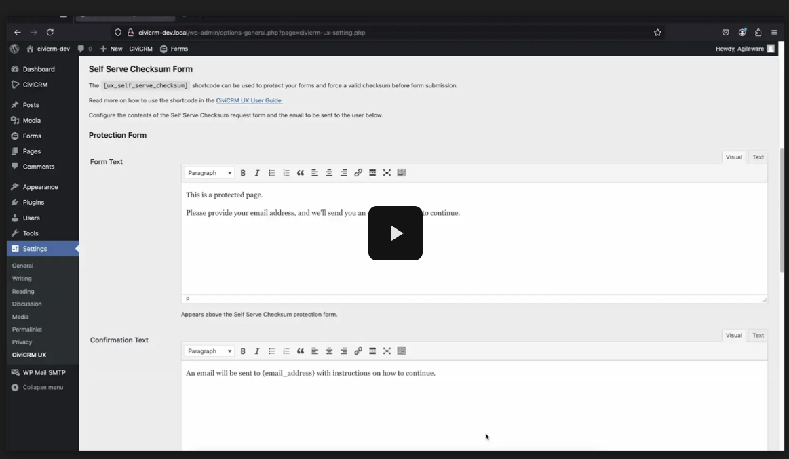

# Self Serve Checksum Form

Watch the video below which demonstrates how to use the Self Serve Checksum Form.

[](https://drive.google.com/file/d/1FZk2okVlxxqDQg178vOorxbEVDGMLVVD/view?usp=drive_link)

## Shortcode
`[ux_self_serve_checksum]`
Protect your CiviCRM integrated forms by forcing users to access them with a valid checksum URL.
Read more about [CiviCRM Checksum Tokens here](https://docs.civicrm.org/user/en/latest/common-workflows/tokens-and-mail-merge/#checksum).

Wrap the content and form you wish to protect in the shortcode. When the page is accessed without a valid checksum in the URL, the Self Serve Checksum Protection Form will be displayed. After providing their email address, an email will be sent to them with a link back to the page containing a valid checksum. The form will then be accessible for them to complete.

```
<!-- wp:shortcode -->
[ux_self_serve_checksum]
<!-- /wp:shortcode -->

<!-- wp:gravityforms/form {"formId":"1","title":false,"inputPrimaryColor":"#204ce5"} /-->

<!-- wp:shortcode -->
[/ux_self_serve_checksum]
<!-- /wp:shortcode -->

<!-- wp:paragraph -->
<p></p>
<!-- /wp:paragraph -->
```

## Settings and Customisation
Comes with settings in the CiviCRM UX settings page to quickly change:
  - the content of the Self Serve Checksum protection form text
  - the content of the confirmation message shown when the email submitted has a valid Contact record in CiviCRM
  - the content of the invalid contact message shown when the email submitted is not in CiviCRM
  - the email message sent to the user with the link to view the form

Also comes with the following filter hooks:
  - *`ux_self_serve_checksum_email_subject`* - Changes the subject line for the email sent to user.

```
// Hook to modify the subject line of the Self Serve Checksum email
add_filter('ux_self_serve_checksum_email_subject', function($subject, $pageTitle) {
    $subject = $pageTitle . This is a custom subject line modified by filters';
    return $subject;
}, 10, 2);
```

## Cloudflare Turnstile
You can protect your Self Serve Checksum Form against spam using the free service [Cloudflare Turnstile](https://www.cloudflare.com/en-gb/products/turnstile/). Once you have a sitekey and secret key, simply add them to the settings.
